<p align="center">
  
</p>

<p align="center">
  
  
  
  
  
  
</p>

<p align="center">
  <b>Menos tokens. Mais engenharia.</b> O agente para de varrer o repositório e passa a perguntar a um índice local onde o código está.
</p>

> [!WARNING]
> **Alpha (v0.1.4).** Há binário pronto para **Windows x64** (testado), **Linux x64 e arm64** (compilam e instalam, mas ainda não foram executados em um Linux real) e **nenhum para macOS** (até lá, [compile do código](#instalação)). Foi exercitado de ponta a ponta com o Claude Code, o Codex e o OpenCode reais, no Windows. Perguntas em linguagem natural ainda erram com frequência (veja [Benchmarks](#benchmarks) e [limitações](docs/limitations.md)). Relatos de falhas são bem-vindos nas [issues](https://github.com/devadeiltonlima/devzymer/issues).

O devzymer indexa o seu repositório localmente e entrega ao agente de código (Claude Code, Codex, OpenCode) **o arquivo, o símbolo e a faixa de linhas exata**, em vez de deixá-lo rodar `grep` e abrir arquivos inteiros.

- **Tudo local.** Parsing com Tree-sitter, índice em SQLite, busca por BM25 (FTS5). Nenhuma chamada de rede, nenhum LLM no caminho de busca.
- **Determinístico e auditável.** Cada resposta diz *por que* o candidato foi escolhido (`heuristic`, `confirmado`) e uma busca sem resultado devolve `not_found`, nunca um local inventado.
- **Não é um índice vetorial.** Sem embeddings: léxico, estrutura e grafo de chamadas, com vocabulário bilíngue PT↔EN para perguntas em linguagem natural.
- **Um `init` basta.** Um observador de filesystem mantém o índice sincronizado enquanto o servidor MCP roda.

**Comece em 30 segundos.** Sem clonar o repositório e sem precisar de Rust:

```powershell
# Windows (PowerShell)
irm https://github.com/devadeiltonlima/devzymer/releases/latest/download/install.ps1 | iex
```

```bash
# Linux / macOS
curl -fsSL https://github.com/devadeiltonlima/devzymer/releases/latest/download/install.sh | sh
```

Depois, dentro do **seu** projeto:

```bash
devzymer init                  # você escolhe os agentes; ele indexa, registra o MCP e verifica
```

Depois, no seu agente, é só pedir:

> "Encontre e corrija a função que valida sessões de usuário."

Pronto. O `init` deixa **três coisas** no projeto:

```
seu-projeto/
├── .devzymer/index.sqlite3   o índice local (símbolos, grafo, FTS5)
├── .mcp.json                 o servidor MCP (Claude Code; Codex usa .codex/config.toml
│                             e OpenCode usa opencode.json)
└── CLAUDE.md / AGENTS.md     as regras de uso, em um bloco delimitado e removível
```

**Um instalador, vários agentes.** Claude Code, Codex e OpenCode, no mesmo `init`: [escolha os agentes](#instalação).

---

## Veja funcionando

<p align="center">
  
</p>

Saídas reais, do devzymer rodando sobre o **próprio repositório** (406 arquivos, 1.447 símbolos). A animação repete quatro etapas: **localizar**, **o que o agente recebe**, **estado do índice** e **medir**.

<details>
<summary><b>Ver as mesmas saídas em texto</b> (para copiar)</summary>

```text
$ devzymer resolve "Store fts search lexical" --root . --limit 4
arquivo: crates/devzymer-core/src/store.rs | 110 símbolo(s) | nome do arquivo na consulta: Store
crates/devzymer-core/src/store.rs:1472-1496 | tests.replacing_symbols_keeps_the_lexical_index_consistent | function | heuristic
crates/devzymer-core/src/store.rs:1445-1469 | tests.the_lexical_index_keeps_the_words_of_a_camel_case_name | function | heuristic
crates/devzymer-core/src/store.rs:748-802 | Store.fts_search_terms | function | heuristic
crates/devzymer-core/src/store.rs:341-361 | Store.rebuild_lexical_index | function | heuristic

$ devzymer status --root .
índice: 406 arquivos, 1447 símbolos, 6718 relações, revisão 210
idiomas: unknown=318, rust=68, python=20
atualidade: 0 arquivo(s) alterado(s) desde o último índice
integração MCP: instalada | Claude Code CLI: presente
permissão das ferramentas MCP: concedida

$ devzymer doctor --root .
...
12 verificação(ões), 0 falha(s)
```

A resposta traz **o que o agente precisa para ler só aquele trecho**: caminho, faixa de linhas, símbolo, tipo e a origem do acerto. Para ler, o agente chama `context_read` nessa faixa, e não no arquivo inteiro.

E o benchmark, no mesmo repositório (reproduza com o comando abaixo):

```text
$ devzymer benchmark --root . --tasks 16 --seed 20260319
tarefas únicas: 113 | execuções: 113 | verificadas: 92 | não verificadas: 0
acerto no top 5: 90 (97.8%) | recall@1 88.0% | recall@5 92.4% | MRR 0.897
latência: média 3.4 ms | p50 2.0 | p95 10.0 | p99 15.0
tokens: 91009 de contexto | 429632 de linha de base | redução +78.82%
```

</details>

---

## O que ele faz

| Capacidade | O que você recebe |
|---|---|
| **Resolver** | Símbolo, arquivo ou pergunta em linguagem natural → caminho, faixa de linhas e símbolo, em uma chamada |
| **Ler** | Um trecho preciso, por símbolo ou por faixa, nunca o arquivo inteiro |
| **Impacto** | Quem chama, quem depende e o que quebra, antes de mexer em código compartilhado |
| **Patch atômico** | Edição mínima com verificação de revisão (`expected_sha`); edição sobre arquivo desatualizado é rejeitada |
| **Grafo de chamadas** | Relações `calls` / `imports` / `extends` resolvidas a partir da AST |
| **Evidência explicada** | Cada candidato carrega o motivo (campo e raridade do termo que casou) |
| **Honestidade** | Símbolo inexistente → `not_found: true`. Nada de caminho inventado |
| **Roteamento do agente** | `prefer` (padrão) orienta e mede; `guard`, por opt-in, redireciona **uma vez** a busca que o índice sabe responder. Sempre há saída: índice defasado, MCP fora do ar ou falha do devzymer liberam a busca nativa. Ver [docs/routing.md](docs/routing.md) |
| **Sempre atual** | Observador de filesystem + reconciliação ao abrir a sessão |
| **Local-first** | O conteúdo do repositório só sai da máquina com consentimento explícito |

---

## Benchmarks

**−86% de contexto no repositório real e 100% de acerto nos dois conjuntos de generalização.**

| Conjunto | Métrica | Motor anterior (v21) | **devzymer v2.1** |
|---|---|---|---|
| Repositório real (807 arquivos, 24.664 símbolos, 463 tarefas) | Perguntas em linguagem natural | 2/9 | **4/9** |
| | Símbolos inexistentes recusados | 5/5 | **5/5** |
| | Tokens de contexto vs. linha de base | 263.269 (−89,10%) | **326.553 / 2.415.877 (−86,48%)** |
| Generalização (dev) | Acerto · R@1 · MRR | 94,90% · 0,650 · 0,762 | **100% · 0,962 · 0,965** |
| Generalização (holdout) | Acerto · R@1 · MRR | 94,27% · 0,713 · 0,804 | **100% · 0,987 · 0,990** |
| Conjunto independente (36 investigações) | Acertos | 23/36 | **26/36** |

Mesmos dados, mesma semente (`20260319`), os dois binários sobre o **mesmo índice**. Reproduza:

```bash
devzymer benchmark --root <dir> --tasks 64 --seed 20260319 --format json
```

**Leia com ceticismo, é o que fazemos:**

- Os tokens são uma **estimativa local** (`heuristic-chars-v1`), não a cobrança do seu provedor.
- O motor v2.1 entrega **mais contexto** do que o anterior (indexa o corpo e devolve a implementação completa), então a redução caiu de 89,1% para 86,5% enquanto a precisão subiu.
- No repositório real, a latência média subiu de ~9 ms para ~12 ms (p95 ~35 ms): o v2.1 faz uma expansão e uma segunda consulta.
- No repositório real, perguntas em linguagem natural acertam **4 de 9**, e o recall@1 nelas é 0,33. É o ponto mais fraco e está em [limitações](docs/limitations.md).
- O desempate entre candidatos de mesmo nome depende da ordem física do índice; os números são determinísticos para um dado índice, mas reindexar pode mover algumas posições.

**[Abra o benchmark animado](https://devadeiltonlima.github.io/devzymer/docs/benchmark.html)** (HTML autônomo, sem rede) · metodologia em [docs/benchmarks.md](docs/benchmarks.md) · medição ponta a ponta com o Claude Code em [docs/end-to-end-benchmark.md](docs/end-to-end-benchmark.md).

---

## Documentação

- **[Instalação](docs/installation.md)** e **[CLI](docs/cli.md)**: todos os comandos e flags
- **[Integração MCP](docs/mcp.md)**: as ferramentas e o contrato de resposta
- **[Roteamento do agente](docs/routing.md)**: modos, mecanismo por host, fallback e telemetria
- **[Configuração](docs/configuration.md)**: chaves e ajuste do ranking
- **[Arquitetura](docs/architecture.md)** · **[Indexação e sincronização](docs/indexing.md)** · **[Linguagens](docs/languages.md)**
- **[Segurança e privacidade](docs/security.md)** · **[Migração e desinstalação](docs/migration.md)**
- **[Diagnóstico](docs/troubleshooting.md)** · **[Limitações conhecidas](docs/limitations.md)** · **[Jev](docs/jev.md)**

---

## Pré-requisitos

| Requisito | Mínimo | Verificar | Instalar |
|---|---|---|---|
| Um agente MCP | Claude Code, Codex ou OpenCode | `claude --version` | o do seu agente |
| Rust *(só para compilar do código)* | 1.85 | `rustc --version` | [rustup.rs](https://rustup.rs) |
| Windows *(só para compilar)* | Visual Studio Build Tools com *Desktop development with C++* | `cl` no Developer Prompt | [visualstudio.microsoft.com](https://visualstudio.microsoft.com/visual-cpp-build-tools/) |
| Python *(opcional)* | 3.10+ | `python --version` | só para os scripts de regressão |

O instalador de uma linha baixa um binário pronto: não exige Rust, Python nem Node.

---

## Instalação

**1. Instale o binário** (uma vez por máquina):

```powershell
# Windows (PowerShell)
irm https://github.com/devadeiltonlima/devzymer/releases/latest/download/install.ps1 | iex
```

```bash
# Linux / macOS
curl -fsSL https://github.com/devadeiltonlima/devzymer/releases/latest/download/install.sh | sh
```

O script baixa o binário da sua plataforma na página de releases, **confere o SHA-256** e o instala
(`%LOCALAPPDATA%\devzymer\bin` no Windows, `~/.local/bin` no Linux e macOS), adicionando ao `PATH`
quando necessário. Se o checksum não confere, nada é instalado.

<details>
<summary><b>Variáveis do instalador</b> (clique para expandir)</summary>

| Variável | Efeito |
|---|---|
| `DEVZYMER_VERSION` | versão a instalar, por exemplo `v0.1.4` (padrão: a última) |
| `DEVZYMER_INSTALL_DIR` | pasta de destino |
| `DEVZYMER_NO_MODIFY_PATH` | `1` para não alterar o `PATH` (só Windows) |
| `DEVZYMER_REPO` | `devadeiltonlima/devzymer`, para instalar de um fork |
| `DEVZYMER_BASE_URL` | pasta ou espelho com os arquivos de release |

Plataformas com binário pronto: Windows x64, Linux x64 e arm64, macOS Intel e Apple Silicon.

</details>

**Outras formas de instalar**

```bash
cargo install --git https://github.com/devadeiltonlima/devzymer devzymer-cli --locked   # precisa de Rust

git clone https://github.com/devadeiltonlima/devzymer && cd devzymer                    # compila do código
cargo build --release
```

**2. Ative no seu projeto** e escolha os agentes:

```bash
devzymer init                      # interface de terminal para escolher os agentes
devzymer init --agents claude,codex,opencode --yes     # sem interação
devzymer doctor                    # 12 verificações, 0 falhas
```

<details>
<summary><b>Opções do instalador</b> (clique para expandir)</summary>

| Flag | Efeito |
|---|---|
| `--agents <LIST>` | `claude`, `codex`, `opencode`, separados por vírgula |
| `--scope <ESCOPO>` | `project` (padrão), `local` ou `user` (todos os projetos e hosts) |
| `--full` | reindexa tudo, ignorando o cache incremental |
| `--server-only` | registra só o servidor MCP, sem regras nem hooks |
| `--no-integrate` | não instala a integração (só indexa) |
| `--dry-run` | só detecta o ambiente, sem escrever nada |
| `--yes` | não abre a interface interativa |

</details>

> [!TIP]
> Quer ver o que o `init` faria antes de escrever qualquer coisa? `devzymer init --dry-run --yes`.

---

## Faça seu agente sempre usar o índice

O `init` já faz isto. Por agente:

| Agente | O que é instalado |
|---|---|
| **Claude Code** | servidor MCP (`.mcp.json`), **permissão** das ferramentas `mcp__devzymer__*`, regras (`CLAUDE.md`), a **skill `devzymer`** (`.claude/skills/devzymer/`) e os hooks `guard-search`, `note-mcp`, `note-prompt`, `guard-test-files` e `post-tool-use` |
| **Codex** | servidor MCP (`.codex/config.toml`), regras (`AGENTS.md`), a **skill `devzymer`** (`.agents/skills/devzymer/`) e hooks de roteamento (`.codex/hooks.json`, ativos só depois da revisão em `/hooks`) |
| **OpenCode** | servidor MCP (`opencode.json`), regras (`AGENTS.md`), a **skill `devzymer`** (`.agents/skills/devzymer/`) e o plugin de roteamento (OpenCode 2), preservando comentários do seu `opencode.jsonc` |

As regras e a skill ficam no projeto, em blocos e arquivos que o devzymer reconhece como seus: o que você escreveu, ou editou, nunca é substituído ([detalhes da skill](docs/agent-skill.md)).

Sem a permissão, o Claude Code rejeita cada chamada com `you haven't granted it yet`, e o agente volta a varrer o repositório por conta própria; por isso o instalador a concede no escopo registrado. No modo `guard` (opt-in), o roteamento nega a busca nativa **somente quando o índice sabe responder** e nunca nega a mesma busca duas vezes.

Para remover **apenas o que o devzymer instalou**: `devzymer uninstall` (o índice fica; `--purge` apaga também). Para mexer em um agente só: `devzymer integrations add|remove|repair|verify`.

---

## O que o agente recebe

Sete ferramentas MCP. A ordem importa: **resolver → ler → impacto → patch**.

| Ferramenta | Quando chamar |
|---|---|
| `context_resolve` | antes de qualquer `grep` ou leitura: localiza símbolo, arquivo e faixa de linhas |
| `context_read` | para ler **um** trecho preciso, por símbolo ou por faixa |
| `context_impact` | antes de mudar código compartilhado: quem chama, quem depende |
| `context_patch` | para aplicar uma edição mínima, com verificação de revisão |
| `context_status` | frescor, observador, pendências, arquivos ignorados |
| `context_sync` | quando o índice estiver velho (depois de um pull, por exemplo) |
| `context_decide` | quando as regras locais de roteamento não bastarem ([Jev](docs/jev.md)) |

Duas garantias do contrato:

- **Busca vazia é sucesso, não erro.** Símbolo inexistente → `not_found: true`. Argumentos inválidos, revisão ausente ou obsoleta e caminho fora do workspace continuam sendo erro (`isError`).
- **`path` é filtro.** Restringe a busca ao arquivo ou diretório indicado e nunca é tratado como bônus silencioso de ranking.

Saídas compactas por padrão; a expansão é pedida. Contrato completo em [docs/mcp.md](docs/mcp.md).

---

## Comandos mais usados

```bash
devzymer init                          # indexa, registra o MCP e verifica
devzymer status --root .               # cobertura, atualidade e integração
devzymer doctor --root .               # diagnóstico completo
devzymer sync --root .                 # reindexa só o que mudou
devzymer sync --full --root .          # reconstrói tudo (use após atualizar o devzymer)
devzymer resolve "<símbolo ou pergunta>" --root . --limit 5   # a mesma busca, sem MCP
devzymer resolve "<termo>" --root . --json

devzymer update                        # atualiza para a última versão publicada (--check só informa)
devzymer config list --root .          # preferências efetivas, com origem
devzymer config set routing.mode prefer --root .
devzymer routing status --root .       # modo, mecanismo por host, saúde e telemetria
devzymer routing mode guard --root .   # opt-in: redireciona buscas redundantes
devzymer maintain --root .             # checkpoint do WAL, cache, espaço livre
devzymer integrations list --root .    # o que está instalado e onde
devzymer migrate --root . --dry-run    # plano de migração de outras ferramentas
devzymer benchmark --root . --tasks 64 --seed 20260319 --format json --output relatorio.json
devzymer serve --root .                # servidor MCP por stdio (os agentes chamam isto)
```

Todos aceitam `--root <DIR>` (valor obrigatório quando presente), `--json` e `--verbose`. Referência completa em [docs/cli.md](docs/cli.md).

---

## Roteamento do agente

O servidor MCP não garante que o modelo o escolha. O roteamento observa as buscas nativas do
agente (`Grep`, `Glob`, `rg`, `grep`, `findstr`, `Select-String`, `find`) e decide, com o índice
na mão, se o devzymer pode responder.

| Modo | Efeito |
|---|---|
| `off` | não interfere |
| `prefer` (padrão) | dica curta, no máximo 3 por sessão, e telemetria; nunca bloqueia |
| `guard` (opt-in) | redireciona **uma vez** a busca que o índice sabe responder; a repetição passa |

Sempre há saída: servidor MCP fora do ar, índice ausente, defasado, corrompido ou de outro
workspace, falha recente do devzymer, pedido explícito de busca nativa, logs e saída de
comandos, e buscas fora do índice liberam a busca nativa. O hook abre o índice somente leitura,
não altera arquivos e não indexa.

| Host | Mecanismo | Garantia |
|---|---|---|
| Claude Code | hooks `PreToolUse`, `PostToolUse` e `UserPromptSubmit` | técnica, no modo `guard` |
| OpenCode 2 | plugin com `execute.before` | técnica, no modo `guard` |
| Codex | `.codex/hooks.json` e `AGENTS.md` | os hooks só rodam depois da revisão em `/hooks`; antes disso, só orientação |

**O que foi medido.** Em 36 tarefas reais no Claude Code (haiku), o agente já escolhia o
devzymer primeiro em 100% dos casos, com ou sem roteamento: não há ganho a mostrar nesse
modelo. A diferença medida foi nos bloqueios indevidos: a guarda anterior bloqueou 2 de 26
tarefas (uma sem MCP não concluiu) e a nova, 0. No OpenCode 2, o MCP em Code Mode fazia o
modelo ignorar o devzymer (0%); com `codemode: false`, que o instalador agora grava, ele
passou a usá-lo. O Codex não foi medido. Economia de tokens do roteamento não é medida nem
alegada. Detalhes e limites em [docs/routing.md](docs/routing.md) e
[docs/limitations.md](docs/limitations.md).

---

## Configuração

Preferências por seção, no projeto (`.devzymer/config.toml`) ou no escopo do usuário (`devzymer config path` mostra os dois caminhos):

| Chave | Padrão | Para que serve |
|---|---|---|
| `index.exclude` | lista longa | diretórios ignorados (`node_modules`, `dist`, `target`…) |
| `index.max_file_size_bytes` | 2.000.000 | arquivos maiores não são indexados |
| `index.respect_gitignore` | `true` | respeita o `.gitignore` |
| `search.max_results` | 20 | candidatos por resposta |
| `search.default_token_budget` | 2000 | orçamento de tokens por leitura |
| `search.snippet_max_lines` | 40 | linhas por trecho |
| `search.bm25_*_weight` | 1,0 | peso por coluna (`name`, `qualified`, `signature`, `doc`, `body`) |
| `context.cache_enabled` | `true` | cache de resolução entre chamadas |
| `routing.mode` | `prefer` | `off`, `prefer` ou `guard` (ver [docs/routing.md](docs/routing.md)) |
| `context.guard_search` | `false` | legado: `true` equivale a pedir `routing.mode = guard` |
| `context.max_output_tokens` | 4000 | teto de saída de uma ferramenta |
| `privacy.allow_remote_source` | `false` | permite enviar conteúdo do repositório a provedores externos |

Matriz completa em [docs/configuration.md](docs/configuration.md).

---

## Como funciona

```
devzymer-core          modelos, configuração, persistência SQLite, workspace
devzymer-indexer       varredura, Tree-sitter, extração de símbolos, incremental
devzymer-graph         relações, consultas de dependência, análise de impacto
devzymer-search        recuperação em cascata, ranking por evidência, leitura de trechos
devzymer-context       orçamento de tokens, divulgação progressiva, cache
devzymer-decisions     Jev, fallback determinístico, circuit breaker
devzymer-mcp           servidor MCP, contratos das ferramentas, patch atômico
devzymer-integrations  adaptadores Claude Code, Codex e OpenCode, detecção, migração
devzymer-tui           interface de terminal da seleção de agentes
devzymer-bench         harness de benchmark e contabilidade de tokens
devzymer-cli           o executável `devzymer`
```

O índice guarda símbolos, relações e um índice FTS5 que inclui o **corpo** do código. A busca combina nome, arquivo, qualificador e assinatura com a evidência do corpo, pesada pela **raridade do termo** e pelo campo onde ele apareceu, e expande perguntas em linguagem natural com o vocabulário do próprio repositório. Visão completa em [docs/architecture.md](docs/architecture.md).

---

## Linguagens

TypeScript, JavaScript, Python e Rust têm extração por AST (Tree-sitter). Os demais arquivos entram no índice como texto. Matriz e limites em [docs/languages.md](docs/languages.md).

---

## Privacidade

- **O índice nunca sai da máquina.** Conteúdo de repositório só vai a provedores externos com consentimento explícito (`privacy.allow_remote_source`, desligado por padrão).
- **Arquivos sensíveis não são indexados** (`.env`, chaves privadas, credenciais) e padrões de segredo conhecidos são barrados na varredura.
- **Tudo é confinado ao workspace.** Caminhos que escapam são rejeitados, inclusive em patch (`PATCH_OUTSIDE_WORKSPACE`).
- **Patch atômico:** verificação de revisão obrigatória (`expected_sha`), revisão obsoleta rejeitada, `dry-run` que nunca escreve.
- **Segredos em variáveis de ambiente**, nunca em log, cache ou relatório.
- **Sem telemetria**, sem rastreamento de uso, sem analytics.

Detalhe em [docs/security.md](docs/security.md).

---

## Diagnóstico

| Sintoma | Causa provável | O que fazer |
|---|---|---|
| `you haven't granted it yet` no Claude Code | permissão das ferramentas MCP ausente | `devzymer integrations repair --root .` |
| Resultados antigos depois de atualizar o devzymer | o parser mudou e o índice ainda é do parser anterior | `devzymer sync --full --root .` |
| `status` aponta arquivos alterados | o observador não está rodando | `devzymer sync --root .` ou abra uma sessão com o MCP ativo |
| Índice cresceu demais | WAL e páginas livres | `devzymer maintain --root .` |
| Comando falha com `--root` | `--root` exige um valor | `--root .` ou omita a flag |

Mais casos em [docs/troubleshooting.md](docs/troubleshooting.md). Se algo parecer errado, comece por `devzymer doctor`.

---

## Desenvolvimento

```bash
cargo build                        # build de desenvolvimento
cargo test                         # testes embutidos
cargo clippy --all-targets -- -D warnings
cargo fmt --check

python scripts/mcp_smoke.py        # protocolo MCP real, por stdio
python scripts/patch_check.py      # patch atômico, revisão e limite de workspace
python scripts/regression_workspace.py
python scripts/regression_patch.py
python scripts/regression_phases.py
```

Os scripts usam o executável de `DEVZYMER_BIN` (ou `target/release`). Para exercitar um projeto real nos testes de ranking, aponte `DEVZYMER_TEST_PROJECT` para um workspace já indexado. O corpus de consultas curadas do benchmark é lido de `.devzymer/curated.json` no workspace medido; sem o arquivo, o cenário curado é omitido.

Contribuições são bem-vindas, em especial **casos em que a busca errou** (consulta, resposta e o arquivo esperado) e **relatos de linguagens sem extração por AST**.

---

## Idioma

O código e a arquitetura são escritos em inglês. A saída da CLI, as mensagens de erro e a documentação voltadas ao usuário final são em português do Brasil.

---

## Licença

MIT
